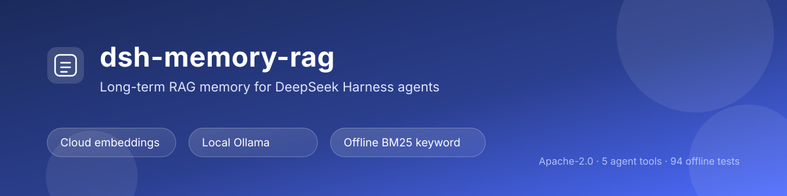

# dsh-memory-rag

[](https://github.com/aonysen/dsh-memory-rag/actions/workflows/ci.yml)
[](https://www.npmjs.com/package/dsh-memory-rag)
[](LICENSE)
[](https://github.com/topics/dsh-plugin)



Semantic memory for **DeepSeek Harness**: memories live in a local vector store and are retrieved on demand instead of being pasted into the system prompt.

Works with **any OpenAI-compatible embeddings endpoint**: Qwen (China/international), SiliconFlow, OpenAI, local Ollama, or a fully custom endpoint. A fully offline BM25 keyword mode is included for when you want no network and no model at all.

## Features

- `rag_search` — natural-language search over stored memories, returning snippets with ids and scores;
- `rag_remember` — store one reusable fact (embedded immediately, searchable right away);
- `rag_ingest` — chunk and import `.md/.mdx/.txt` files or directories (idempotent, skips duplicates);
- `rag_forget` / `rag_stats` — delete and inspect;
- **Session index injection** — at session start the prompt gets a locally rendered index (pinned notes, recent project notes, file groups). No network call, stable across turns;
- **Settings page** — provider, API key, model/dimensions, retrieval parameters, connection test, model listing, memory browser;
- **Memory insights page** — first-level sidebar panel with KPIs, daily additions, composition, tags, recent writes, storage and a 56-day activity heatmap.

## Install

**From npm** (after the npm release, recommended):

```bash
dsh plugin add dsh-memory-rag
```

**From GitHub** (works today; installs the `main` branch):

```bash
dsh plugin add github:Aonysen/dsh-memory-rag
```

**From the DSH UI**: sidebar → **Plugins** → **Add plugin**, then paste `dsh-memory-rag` or `github:Aonysen/dsh-memory-rag` (a local directory path also works while developing).

**From the plugin market**: sidebar → **Plugins** → **Discover**, search for `memory`, and use the install action on the card.

Restart the DSH desktop app after installing, reload the page, then open Settings → **RAG Memory**.

> Upgrading from the pre-release `dsh-rag-memory` package: remove it
> (`dsh plugin --profile <name> remove dsh-rag-memory`), install `dsh-memory-rag`,
> and restart. The data directory is unchanged, so memories and the API key carry over.

## Providers

| id | Endpoint | Default model | Key env var |
|---|---|---|---|
| `qwen-cn` | `https://dashscope.aliyuncs.com/compatible-mode/v1` | `text-embedding-v4` | `DASHSCOPE_API_KEY` |
| `qwen-intl` | `https://dashscope-intl.aliyuncs.com/compatible-mode/v1` | `text-embedding-v4` | `DASHSCOPE_API_KEY` |
| `siliconflow` | `https://api.siliconflow.cn/v1` | `BAAI/bge-m3` | `SILICONFLOW_API_KEY` |
| `openai` | `https://api.openai.com/v1` | `text-embedding-3-small` | `OPENAI_API_KEY` |
| `ollama` | `http://127.0.0.1:11434/v1` | `nomic-embed-text` | optional |
| `custom` | your own | your own | `EMBEDDING_API_KEY` |
| `keyword` | no endpoint | `bm25` (no vectors) | none |

> One store is bound to one model + dimension. Changing either requires an empty store (the settings page refuses otherwise).

### Fully local (no cloud API)

Two options:

1. **Local Ollama** (best recall, still local inference)
   - Install [Ollama](https://ollama.com/) and pull an embedding model: `ollama pull bge-m3` (1024 dims) or `ollama pull nomic-embed-text` (768 dims);
   - Pick the Ollama provider, keep `http://127.0.0.1:11434/v1`, select the model;
   - **No API key required** (`keyOptional`, no auth header is sent).
2. **Local keyword (BM25)** (zero dependencies, zero downloads, works offline)
   - Pick the keyword provider; no endpoint, no model, no key;
   - Great for proper nouns, exact phrases and code identifiers; weaker on paraphrase than vector mode.

> Switching from vector to keyword mode does **not** require clearing the store (keyword mode reads text only); switching back does.

## Settings

- Endpoint: provider preset, base URL, effective `/embeddings` URL.
- API key: paste / clear / status and source; the API never reads the key back.
- Model: preset dropdowns, or free text plus "List models" for custom endpoints.
- Retrieval: topK, minimum score, index character cap, inject-index toggle.
- Status: mode, endpoint, notes/doc chunks/project/global/pinned distribution, storage sizes, revision, write lock, tokens, tags, last five writes; auto-refreshes every 10 seconds.
- Memory browser: keyword search, paging, pin/unpin, delete.

Values persist to `<dataDir>/settings.json` and take precedence over `cordis.patch.yml`; changes apply immediately.

## Memory insights page

A first-level sidebar panel (`sidebar.panellist` entry backed by the `main` keyed slot) laid out like the dsh-context insights page:

- six KPI tiles: memories / notes / doc chunks / project / global / pinned;
- daily additions bar chart (7 / 30 / 90 days);
- composition donut (notes vs doc chunks);
- scope progress bars and tag distribution bars;
- last 10 writes, storage breakdown, 56-day activity heatmap.

Data comes from `GET /dsh-memory-rag/api/dashboard?days=7|30|90`, derived purely from local entry timestamps — no network, no API key required.

## Key sources (resolved per request)

1. Environment variable (provider default, e.g. `DASHSCOPE_API_KEY`);
2. DSH credentials service, when the host provides one;
3. `<dataDir>/api-key` (written by the settings page, mode 600).

## Configuration

```yaml
- id: dsh-memory-rag
  name: dsh-memory-rag
  config:
    provider: qwen-cn
    baseUrl: https://dashscope.aliyuncs.com/compatible-mode/v1
    embeddingModel: text-embedding-v4
    dimensions: 1024
    topK: 5
    minScore: 0.25
    injectIndex: true
    maxInjectChars: 1200
    maxChunksPerIngest: 500
    requestTimeoutMs: 20000
    memoryDir: null          # null → <DSH_HOME>/memories/dsh-rag-memory
```

## Data and privacy

- `<DSH_HOME>/memories/dsh-rag-memory/`: `index.jsonl`, `meta.json`, `settings.json`, `api-key`.
- Only text you explicitly remember or ingest is sent to the embedding endpoint; retrieval and ranking stay local.
- Upgrading from the old `dsh-qwen-rag` copies its data on first start (originals are kept).

## Settings API (scripts / advanced)

```
GET    /dsh-memory-rag/api/settings          settings + key status + store stats
POST   /dsh-memory-rag/api/settings          apply a settings patch
POST   /dsh-memory-rag/api/key               write the key { key }
DELETE /dsh-memory-rag/api/key               clear the key
POST   /dsh-memory-rag/api/test              verify the endpoint with a real request
GET    /dsh-memory-rag/api/models            list endpoint models
GET    /dsh-memory-rag/api/status            runtime snapshot (no network)
GET    /dsh-memory-rag/api/memories          memory list ?query=&limit=&offset=
POST   /dsh-memory-rag/api/memories/update   pin/unpin/delete { id, action }
GET    /dsh-memory-rag/api/dashboard         insights snapshot ?days=7|30|90
```

## Troubleshooting

| Symptom | Fix |
|---|---|
| Missing API key | Paste it in Settings, or set the env var and restart |
| 401 | Wrong key, service not enabled, or key/site mismatch |
| 403 | Key lacks the model permission |
| 404 | Base URL is not OpenAI-compatible (usually ends with `/v1`) |
| 429 | Retried twice already; lower `maxChunksPerIngest` or retry later |
| Dimension mismatch | Clear the store and re-ingest after changing model/dimensions |
| `Failed to fetch` in Settings | Desktop pages load from `dsh-app://` (cross-origin): restart the host after upgrading and reload |
| Store busy | Another DSH process is writing; retry (the lock expires after 30s) |
| Insights panel missing | Restart the host and reload the page; the panel is a client module registered at boot |

## Development

```bash
node --test                    # 94 offline unit tests
node scripts/smoke-embed.mjs   # live smoke test (needs a key)
npm pack --dry-run             # verify published contents
```

## License

Apache-2.0
