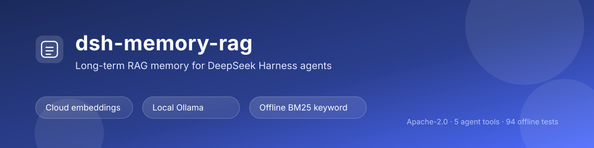

# dsh-memory-rag

[](https://github.com/aonysen/dsh-memory-rag/actions/workflows/ci.yml)
[](https://www.npmjs.com/package/dsh-memory-rag)
[](LICENSE)
[](https://github.com/topics/dsh-plugin)



给 **DeepSeek Harness** 用的语义记忆插件：把「记忆」做成**本地向量库 + 按需语义检索**，不再把整份 markdown 常驻塞进系统提示词。

对接**任意 OpenAI 兼容的 embeddings 端点**：千问（国内/国际）、硅基流动、OpenAI、本地 Ollama，或完全自定义；另有完全离线的 BM25 关键词模式。

## 能力

- `rag_search` — 自然语言检索历史记忆，返回带 id 的片段与相似度；
- `rag_remember` — 写入一条可复用事实（写入即向量化，随即可检索）；
- `rag_ingest` — 把 `.md/.mdx/.txt` 文件或目录切块导入（可重复执行，自动去重）；
- `rag_forget` / `rag_stats` — 删除与状态查看；
- **会话索引注入**：会话开始时注入「置顶 + 当前项目近期 + 文件聚合」的本地索引，不产生网络请求、不随轮次变化；
- **设置页**：切换提供商/端点、管理 API Key、选择模型与维度、调检索参数、测试连接、拉取模型列表、浏览记忆；
- **记忆洞察页**：一级侧栏面板，KPI、每日新增、构成、标签、最近写入、存储与 56 天活跃度。

## 安装

**从 npm 安装**（npm 发布后可用，最推荐）：

```bash
dsh plugin add dsh-memory-rag
```

**直接从 GitHub 安装**（现在就能用，安装的是仓库 main 分支）：

```bash
dsh plugin add github:Aonysen/dsh-memory-rag
```

**在 DSH 界面里装**：侧栏 **插件** → **添加插件**，粘贴 `dsh-memory-rag` 或 `github:Aonysen/dsh-memory-rag`（本地开发时也可以填本目录的绝对路径）。

**从插件市场装**：侧栏 **插件** → **发现**，搜索 `memory`，找到后用卡片的安装按钮。

安装后重启 DSH 桌面端并刷新页面（F5），然后打开 设置 → **RAG 记忆**。

> 从预发布包 `dsh-rag-memory` 升级：先 `dsh plugin --profile <name> remove dsh-rag-memory`，
> 再安装 `dsh-memory-rag` 并重启。数据目录不变，记忆与 API Key 都会沿用。

## 提供商

| id | 端点 | 默认模型 | Key 环境变量 |
|---|---|---|---|
| `qwen-cn` | `https://dashscope.aliyuncs.com/compatible-mode/v1` | `text-embedding-v4` | `DASHSCOPE_API_KEY` |
| `qwen-intl` | `https://dashscope-intl.aliyuncs.com/compatible-mode/v1` | `text-embedding-v4` | `DASHSCOPE_API_KEY` |
| `siliconflow` | `https://api.siliconflow.cn/v1` | `BAAI/bge-m3` | `SILICONFLOW_API_KEY` |
| `openai` | `https://api.openai.com/v1` | `text-embedding-3-small` | `OPENAI_API_KEY` |
| `ollama` | `http://127.0.0.1:11434/v1` | `nomic-embed-text` | 可留空 |
| `custom` | 自填 | 自填 | `EMBEDDING_API_KEY` |
| `keyword` | 不访问端点 | `bm25`（无向量） | 不需要 |

> 同一份记忆库绑定一个模型 + 维度。换模型/维度前需要清空记忆库（设置页会拦截）。

### 本地运行（不依赖云 API）

两种方式，任选其一：

1. **本地 Ollama**（推荐：语义质量最好，仍是本机推理）
   - 安装 [Ollama](https://ollama.com/)，拉一个嵌入模型：`ollama pull bge-m3`（1024 维）或 `ollama pull nomic-embed-text`（768 维）；
   - 设置页 provider 选「本地 Ollama」，Base URL 保持 `http://127.0.0.1:11434/v1`，模型选对应项；
   - **不需要 Key**（该 provider 标记为 keyOptional，不会发鉴权头）。
2. **本地关键词（BM25）**（零依赖、零下载、断网可用）
   - 设置页 provider 选「本地关键词」；不调用任何端点、不下载模型、不需要 Key；
   - 适合专名、原句、代码名检索；同义改写召回弱于向量模式。

> 从向量模式切到关键词模式**不需要清库**（关键词只读文本）；从关键词切回向量仍需清空并重建。

## 设置页

设置 → **RAG 记忆**：

| 区块 | 内容 |
|---|---|
| 服务地址 | 提供商预设、Base URL、当前 embeddings 接口 |
| API Key | 粘贴保存 / 清除 / 状态与来源；**只写不读** |
| 向量模型 | 模型与维度（预设下拉；自定义可手填，支持「拉取可用模型」） |
| 检索与注入 | topK、minScore、索引字符上限、是否注入会话索引 |
| 运行状态 | 模式（云端/本地/关键词）、端点、模型维度、笔记/文档块/项目/全局/置顶分布、存储占用、revision、写锁、tokens、标签分布、最近 5 条写入；默认 10 秒自动刷新 |
| 记忆库 | 关键词搜索、分页浏览、置顶/取消置顶、删除 |

保存位置：`<数据目录>/settings.json`，优先级高于 `cordis.patch.yml`，改完即时生效、无需重启。

## 记忆洞察（一级侧栏页）

侧栏注册一个「记忆洞察」面板（`sidebar.panellist` + `main` keyed slot），风格对齐 dsh-context 的洞察页：

- 6 个 KPI 卡片：总记忆 / 笔记 / 文档块 / 项目 / 全局 / 置顶
- 每日新增柱状图（近 7 / 30 / 90 天可切）
- 构成环形图（笔记 vs 文档块）
- 作用域进度条、标签分布条形
- 最近 10 条写入、存储占用明细
- 56 天活跃度热力图

数据来自 `GET /dashboard?days=7|30|90`，全部由本地条目时间戳推导，不联网、不需要 Key。

## Key 的来源（按优先级，实时解析）

1. 环境变量（随提供商预设，如 `DASHSCOPE_API_KEY`）；
2. DSH 凭据服务（若宿主提供）；
3. `<数据目录>/api-key` 文件（设置页写入的就是这里，权限 600）。

## 配置（cordis）

```yaml
- id: dsh-memory-rag
  name: dsh-memory-rag
  config:
    provider: qwen-cn        # qwen-cn | qwen-intl | siliconflow | openai | ollama | custom
    baseUrl: https://dashscope.aliyuncs.com/compatible-mode/v1
    embeddingModel: text-embedding-v4
    dimensions: 1024
    topK: 5
    minScore: 0.25
    injectIndex: true
    maxInjectChars: 1200
    maxChunksPerIngest: 500
    requestTimeoutMs: 20000
    memoryDir: null          # null → <DSH_HOME>/memories/dsh-rag-memory
```

## 数据与隐私

- 目录：`<DSH_HOME>/memories/dsh-rag-memory/`
  - `index.jsonl`：追加式向量库（删除写墓碑，超阈值自动压缩）
  - `meta.json`：模型/维度/revision/条数
  - `settings.json`：设置页保存项
  - `api-key`：Key 文件（明文，仅本机）
- 只有**显式写入/导入的文本**会发往嵌入端点；检索与排序全在本机。
- 从旧版 `dsh-qwen-rag` 升级时，首次启动会自动把旧目录数据复制过来（原件保留）。

## 排障

| 现象 | 处理 |
|---|---|
| 未配置 API Key | 设置页粘贴，或设环境变量后重启 |
| 401 / invalid_api_key | Key 错误、未开通，或 Key 与站点不匹配 |
| 403 | 该 Key 没有此模型权限 / 未开通服务 |
| 404 | Base URL 不是 OpenAI 兼容地址（通常以 `/v1` 结尾） |
| 429 | 已自动重试 2 次；仍失败则减小 `maxChunksPerIngest` 或稍后再试 |
| 维度不匹配 / 索引由模型 X 生成 | 换过模型或维度 → 清空记忆库后重新导入 |
| 设置页报 `Failed to fetch` | 桌面页面来自 `dsh-app://`，属跨源请求：升级后重启宿主并刷新页面 |
| 索引被另一个进程占用 | 另一个 DSH 进程正在写同一目录；稍后重试（锁 30s 自动回收） |

## 设置 API（脚本/高级用法）

```
GET    /dsh-memory-rag/api/settings         设置 + Key 状态 + 库统计
POST   /dsh-memory-rag/api/settings         应用设置补丁
POST   /dsh-memory-rag/api/key              写入 Key { key }
DELETE /dsh-memory-rag/api/key              清除 Key
POST   /dsh-memory-rag/api/test             真实请求验证端点
GET    /dsh-memory-rag/api/models           拉取端点模型列表
GET    /dsh-memory-rag/api/status           运行状况快照（不联网）
GET    /dsh-memory-rag/api/memories         记忆列表 ?query=&limit=&offset=
POST   /dsh-memory-rag/api/memories/update  置顶/删除 { id, action: pin|unpin|delete }
```

## 开发

```powershell
node --test                    # 94 个单测，无网络
node scripts/smoke-embed.mjs   # 真实链路冒烟（需要 Key）
npm pack --dry-run             # 检查发布产物
```

结构：`index.js`（装配）→ `lib/config.js`（配置/提供商/迁移）、`lib/settings.js`（设置持久化）、`lib/api.js`（设置 API）、`lib/embedder.js`（OpenAI 兼容客户端）、`lib/chunk.js`、`lib/store.js`（向量库 + 锁 + 压缩）、`lib/search.js`、`lib/tools.js`、`lib/inject.js`、`client.js`（设置页）。

## License

Apache-2.0
